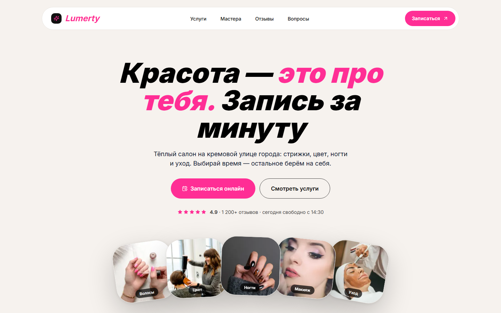

# Lumière Playful — салон красоты



Вторая версия салона Lumière: кремовая бумага, горячий маджента-акцент,
тяжёлый италик в заголовках и почти игрушечная пластика карточек.
Тот же бизнес, другой характер — проект показывает, как один бренд
звучит в двух разных стилях.

**Live:** [beauty-salone-psi.vercel.app](https://beauty-salone-psi.vercel.app) ·
**Код:** [Zurux1337/Lumerty-](https://github.com/Zurux1337/Lumerty-)

## Что внутри

- **Hero** с крупным италиком и адресной строкой-плашкой.
- **Плитка услуг**: пять направлений с фото, ценой и длительностью.
- **Мастера** с фото и специализацией.
- **Отзывы** с аватарами и рейтингом.
- **Запись**: услуга, мастер, дата, время, контакты и SMS-напоминание.
- **FAQ** и финальный CTA на контрастной плашке.
- Анимации появления секций и hover-состояния — с `prefers-reduced-motion`
  и `focus-visible`.

## Дизайн

- Стиль: [`styles/references/playful.md`](../.opencode/skills/styles/references/playful.md) —
  кремовый `#f6f2ee`, чёрный `#111`, один маджента `#ff2e95`.
- Шрифт: Inter, но характер задаёт вес 800 + курсив, а не отдельная гарнитура.
- Крупные радиусы 20–28px, «мягкие» карточки, никакого стекла и градиентов.
- Логотип: чёрная плашка с маджента-искрой — тот же знак, что в favicon.

## Стек

Next.js 16 · React 19 · TypeScript · Tailwind CSS 4 · shadcn/ui (Radix) ·
motion · GSAP · Lenis · lucide-react

## Структура

```
src/
├─ app/
│  ├─ layout.tsx     # шрифты, метаданные
│  ├─ page.tsx       # hero, services, masters, reviews, booking, faq
│  ├─ globals.css    # токены и стили
│  └─ icon.svg       # favicon
├─ components/ui/    # button, dialog
└─ lib/utils.ts      # cn()
```

## Запуск

```bash
npm install
npm run dev      # http://localhost:3000
```

## Проверки

```bash
npm run lint
npm run typecheck
npm run build
npm run start
```

## Демо-дисклеймер

Форма записи не отправляет данные. Цены, мастера, отзывы и фотографии —
демонстрационные.
